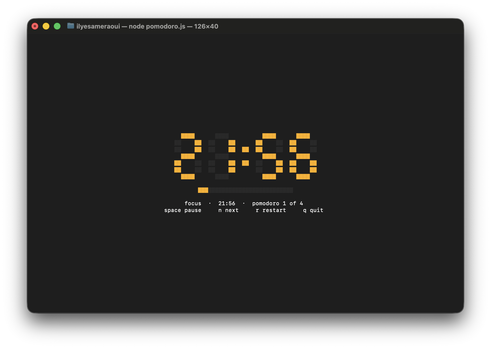

<p align="center">
  
</p>

<h1 align="center">Terminal Pomodoro</h1>

<p align="center">
  A focus timer for the terminal, drawn with seven-segment digits.<br>
  Design created with Coloride.
</p>

<p align="center">
  <a href="https://github.com/IlyesAmeraoui/Terminal-Pomodoro">github.com/IlyesAmeraoui/Terminal-Pomodoro</a>
</p>

## Showcase

<p align="center">
  
</p>

A 25-minute focus block, a progress bar, and a blinking colon. Amber for focus, green for a short break, blue for a long break.

## What it is

Terminal Pomodoro is a local Node timer. It does not open a browser and it does not need extra packages. The digits stay faintly visible when a segment is off, the same way a real display does.

Default cycle:

- 25 minutes of focus
- 5 minutes of short break
- 15 minutes of long break after every 4 focus blocks

## Run

```bash
npm start
```

Or:

```bash
node pomodoro.js
```

It needs an interactive terminal.

## Controls

| Key | Action |
| --- | --- |
| `space` | Start or pause |
| `n` | Skip to the next phase |
| `r` | Restart the current phase |
| `q` | Quit |

## Options

Times are whole minutes, from 1 to 180. Rounds are a whole number from 1 to 12.

```bash
node pomodoro.js --focus 25 --short 5 --long 15 --rounds 4
node pomodoro.js --help
```

A short bell plays when a phase ends. On macOS it uses the system Glass sound.

## Requirements

- Node.js
- A real terminal (`npm start`)

## License

[MIT](LICENSE) © 2026 Ilyes Ameraoui
